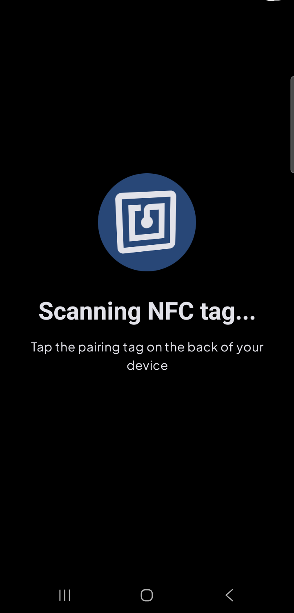
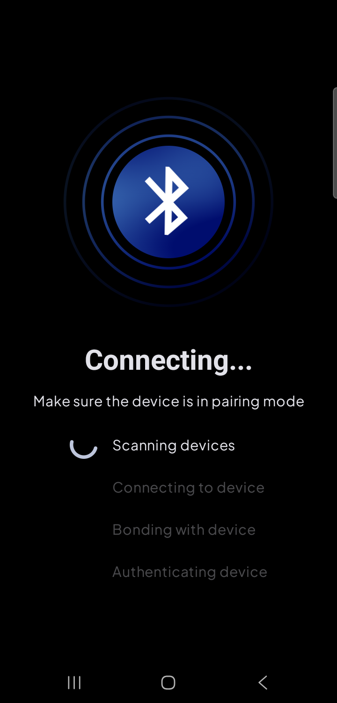
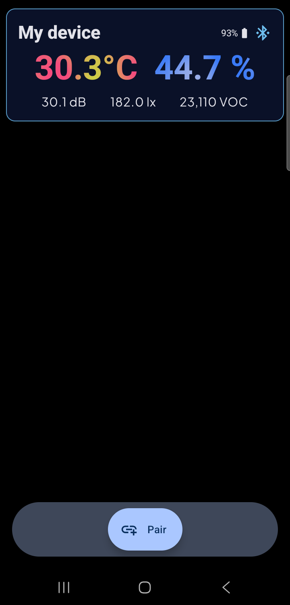
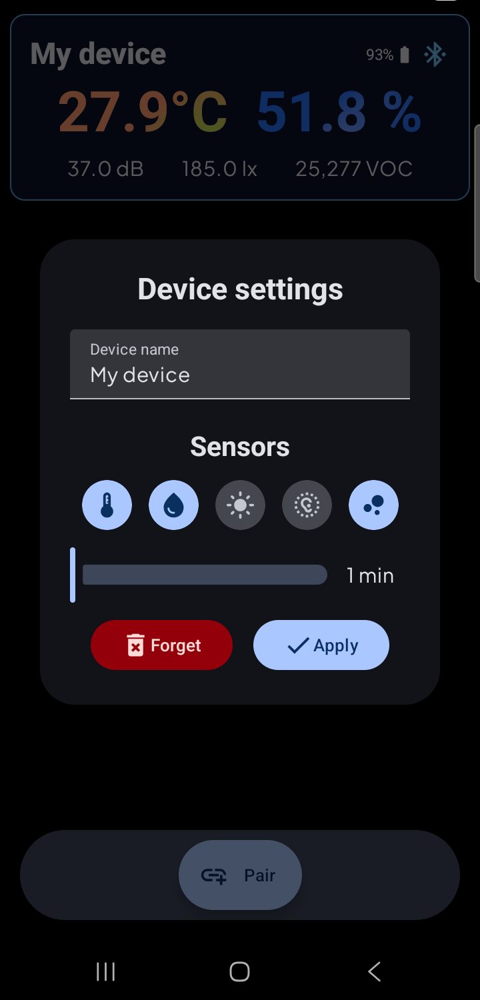
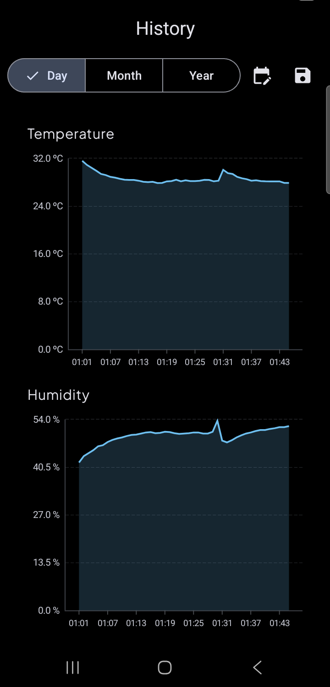
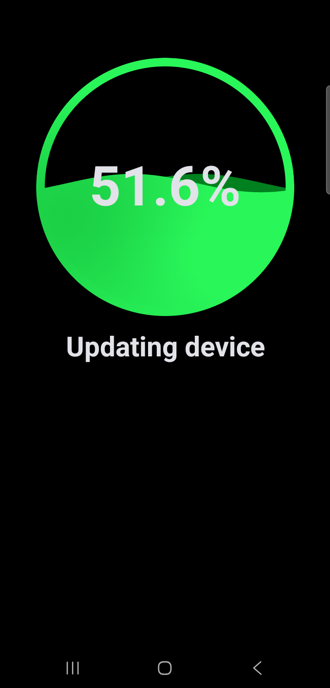

<div align="center">

# $SPV\ Android\ app$
[](https://github.com/UPM-SPV/android-app/actions/workflows/build.yml)
[](https://github.com/UPM-SPV/android-app/releases)
[](https://github.com/UPM-SPV/android-app/blob/master/COPYING)

</div>

Jetpack Compose app to interact with the [**SPV board**](https://github.com/UPM-SPV/pcb). It allows pairing to a board via an NFC tag, modifying its settings, viewing real-time and fetching historical readings, as well as updating its firmware.

> [!WARNING]
> This repository's code is NOT idiomatic. It was made mostly as a learning exercise for ***both*** Jetpack Compose and BLE on Android. So don't expect clean code.

## Screenshots

<table align="center">
	<tr>
		<td align="center">
			
			<b>NFC scan</b>
		</td>
		<td align="center">
			
			<b>BLE pairing</b>
		</td>
	</tr>
	<tr>
		<td align="center">
			
			<b>Dashboard</b>
		</td>
		<td align="center">
			
			<b>Device settings</b>
		</td>
	</tr>
	<tr>
		<td align="center">
			
			<b>Data history</b>
		</td>
		<td align="center">
			
			<b>Update screen</b>
		</td>
	</tr>
</table>

## Building

### Install Android SDK
Install [Android Studio](https://developer.android.com/studio) if you want to be able to modify the app, or only the [Command Line Tools](https://developer.android.com/studio/index.html#command-line-tools-only) if you just want to build it.

### Import keys
Copy your attestation CA's certificate file (see the [firmware](https://github.com/UPM-SPV/firmware#generating-keys) repository) to `config/local/cacert.pem`. The app will use this certificate to perform hardware attestation on every connection.

If you want to build a release version, run `config/keygen.sh` to generate a keystore in `config/local/keystore.jks`. Back this file up, as it is required for building app updates.

To use an existing keystore file instead, copy it to `config/local/keystore.jks`, set its password to `keypassword` (both the `storePassword` and the `keyPassword`), and set your key alias to `key`.

### Compile

Finally, to build the release APK, run:

```shell
$ ./gradlew assembleRelease
```

You'll find the built APK in `./app/build/outputs/apk/release/app-release.apk`.

To build a debug version, run

```shell
$ ./gradlew assembleDebug
```

The debug APK will be stored in `./app/build/outputs/apk/debug/app-debug.apk`.

### Note on releases

While this repository has a release section, it is not useful for end users as it bundles a private CA whose key is not public. This means that it's not possible (for users) to flash boards with a valid attestation certificate from said CA.

You should instead follow the build procedure specified above.

## License
This repository and all of its files are released under the [*GNU General Public License v3.0 **or later***](COPYING) at your own choice.

Additionally, the following files belong to their rightful owners and may be found under their original license:

<table align="center">
	<thead>
		<tr>
			<td align="center"><b>File</b></td>
			<td align="center"><b>Owner</b></td>
			<td align="center"><b>License</b></td>
			<td align="center"><b>Source</b></td>
			<td align="center"><b>Changes</b></td>
		</tr>
	</thead>
	<tbody>
		<tr>
			<td align="center">
				<b><code><a href="/app/src/main/java/gf/gab/upm/spv/ota/ZipPackage.java">ZipPackage.java</a></code></b>
			</td>
			<td align="center">Nordic Semiconductor</td>
			<td align="center">Apache 2.0</td>
			<td align="center">
				<a href="https://github.com/nordicsemi/Android-nRF-Connect-Device-Manager/blob/98b301f56ade5cc9095dede390e8e408c800a073/sample/src/main/java/no/nordicsemi/android/mcumgr/sample/utils/ZipPackage.java">
					Android nRF Connect Device Manager
				</a>
			</td>
			<td align="center">
				Removed Timber integration and renamed imports
			</td>
		</tr>
	</tbody>
</table>

---
Copyright (c) Gabriel Gutiérrez Fuentes 2026
